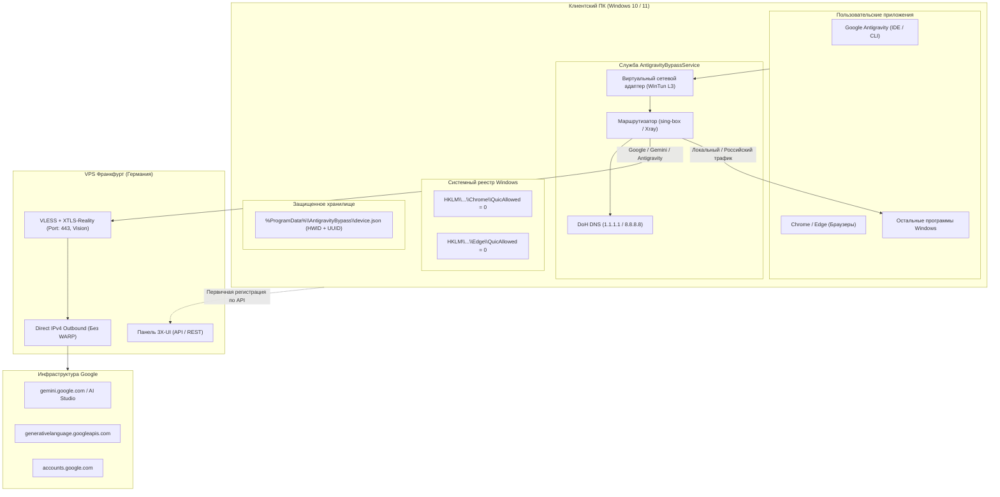

# АРХИТЕКТУРНЫЙ ОТЧЕТ И ТЕХНИЧЕСКАЯ СПЕЦИФИКАЦИЯ ПРОЕКТА
## "AntigravityBypass: Автономный системный патчер обхода геоблоков Google / Gemini & IDE Antigravity"

**Дата формирования:** Октябрь 2026  
**Целевая платформа:** Windows 10 / 11 (x64)  
**Протокол туннелирования:** VLESS + XTLS-Reality (`xtls-rprx-vision`)  
**Серверная инфраструктура:** Франкфурт, Германия (VPS с панелью 3X-UI v2.4+)  
**Целевые сервисы:** Google Gemini (Flash, Pro, Advanced), Google AI Studio, NotebookLM, Google Accounts, эндпоинты среды разработки **Google Antigravity** (`generativelanguage.googleapis.com`, gRPC-стриминг токенов).

---

## 1. ЦЕЛИ И ФИЛОСОФИЯ ПРОЕКТА

### 1.1. Проблема
При использовании классических решений обхода блокировок пользователи на Windows сталкиваются с комплексным детектированием со стороны Google:
1. **Режим «Системного прокси» (WinINET):** Проксирует только часть браузерного TCP-трафика. Служебные запросы, среда Antigravity (Electron/Node.js/Python), WebRTC и UDP-трафик идут напрямую через провайдера РФ.
2. **Утечки DNS и EDNS Client Subnet (ECS):** Рассинхронизация геопозиции (`IP: Германия` vs `DNS/ECS: Россия`) приводит к ошибкам `403 Forbidden`, `Service unavailable in your region` и капче.
3. **Протокол QUIC (UDP 443):** Браузеры Chrome и Edge используют UDP для обращения к Google. При сбоях проксирования UDP происходит сброс на прямой канал и демаскировка региона.
4. **Сбои авторизации в Google Antigravity:** Среда разработки выдает `Error 1155` / `Token validation failed`, так как фоновые процессы IDE не умеют работать с локальными прокси-клиентами без прозрачного L3 TUN-адаптера.
5. **Необходимость сторонних GUI-клиентов:** Hiddify, v2rayN и Nekoray требуют ручного запуска пользователем, занимают ресурсы, висят в трее и могут быть случайно закрыты.

### 1.2. Решение
Создание автономного системного патчера **AntigravityBypass**, который:
- **Разворачивается в 1 клик** с автоматической привязкой к серверу через 3X-UI API.
- **Работает как системная служба Windows (Windows Service)**: запускается до входа пользователя в систему, работает в фоне без GUI и окон консоли.
- **Интегрирует драйвер WinTun (L3 TUN Mode)**: прозрачно для всех программ перехватывает сетевой стек ОС.
- **Реализует строгую аппаратную привязку (HWID)**: сохраняет ключ при обновлениях/переустановках без дублирования клиентов на сервере.
- **Отключает QUIC глобально на уровне политик Windows (Registry Policies)**.
- **Выполняет выборочную маршрутизацию (Split Tunneling)**: сервисы Google идут во Франкфурт, остальные ресурсы РФ/мира — напрямую на полной скорости провайдера.

---

## 2. ГЛУБИННЫЙ АНАЛИЗ ВЕКТОРОВ ДЕТЕКТИРОВАНИЯ GOOGLE (ОКТЯБРЬ 2026)

```
+------------------------------------------------------------------------------------+
|                                ВЕКТОРЫ ДЕТЕКТИРОВАНИЯ GOOGLE                       |
+------------------------------------------------------------------------------------+
| 1. ASN / Datacenter Tagging  -> Сопоставление IP с базами Cloud/Hosting            |
| 2. DNS / ECS Leakage         -> Реальный IP пользователя в EDNS Client Subnet      |
| 3. QUIC / UDP Fingerprint    -> Утечка трафика UDP 443 мимо TCP-туннеля            |
| 4. TLS Fingerprint (JA3/JA4) -> Отличие сигнатуры прокси от стандартного Chrome    |
| 5. Token & Session Binding   -> Конфликт геолокации токенов в Gemini Pro / IDE     |
+------------------------------------------------------------------------------------+
```

### 2.1. Анализ утечек DNS и EDNS Client Subnet (ECS)
Google сопоставляет IP-адрес входящего TCP/TLS-соединения с IP-подсетью, передаваемой резолвером в поле `EDNS Client Subnet` (RFC 7871).
- Если клиент использует локальный DNS провайдера или публичный DNS, передающий российский ECS, запрос маркируется как аномалия.
- **Решение в патчере:** Принудительное перенаправление всех запросов `geosite:google` на удаленные DoH-серверы (`https://1.1.1.1/dns-query`, `https://8.8.8.8/dns-query`) через зашифрованный туннель без передачи ECS.

### 2.2. Протокол QUIC (HTTP/3 через UDP 443)
Chrome и Edge по умолчанию отдают приоритет QUIC. В Windows-клиентах UDP-трафик часто:
- Либо блокируется ТСПУ, вызывая аварийный fallback на открытый стек;
- Либо утекает через основной сетевой шлюз.
- **Решение в патчере:**
  1. В ядре маршрутизации: жесткое правило `network: udp, port: 443 -> block`.
  2. В системном реестре Windows: установка политик `QuicAllowed = 0` для Chrome и Edge. Браузер принудительно переключается на чистый HTTP/2 через TLS в туннеле.

### 2.3. Исключение ловушки Cloudflare WARP на VPS
На многих серверах с 3X-UI трафик к Google заворачивается в Cloudflare WARP. Начиная с осени 2026 года пулы IP-адресов WARP занесены Google в жесткий blacklist для моделей Gemini.
- **Решение в патчере и сервере:** Трафик Google должен выходить исключительно через чистый внешний IPv4 VPS (`outbound: direct / freedom` с параметром `domainStrategy: UseIPv4`).

---

## 3. АРХИТЕКТУРА И СХЕМА РАБОТЫ СИСТЕМЫ



---

## 4. МОДУЛИ И ТЕХНИЧЕСКАЯ РЕАЛИЗАЦИЯ

### 4.1. Модуль HWID и защиты ключей (`hwid.ps1`)
- **Формирование HWID:**
  ```powershell
  $MachineGuid = (Get-ItemProperty -Path "HKLM:\SOFTWARE\Microsoft\Cryptography").MachineGuid
  $BaseBoardSerial = (Get-CimInstance Win32_BaseBoard).SerialNumber
  $RawHWID = "$MachineGuid|$BaseBoardSerial"
  $HWID = (Get-FileHash -InputStream ([System.IO.MemoryStream]::new([System.Text.Encoding]::UTF8.GetBytes($RawHWID))) -Algorithm SHA256).Hash.ToLower()
  $ShortHWID = $HWID.Substring(0, 8)
  ```
- **Хранилище:** `%ProgramData%\AntigravityBypass\device.json`
- **Логика идемпотентности:**
  - При запуске инсталлятора выполняется поиск `device.json`.
  - Если файл существует: UUID считывается локально. API 3X-UI **не вызывается**, что исключает раздувание базы пользователей в панели и блокировку аккаунтов.
  - Если файла нет: генерируется новый клиент через 3X-UI API с email `antigravity_$ShortHWID`, и параметры сохраняются.

### 4.2. Модуль взаимодействия с 3X-UI API (`3xui-client.ps1`)
- **Аутентификация:** `POST {PanelURL}/login` с сохранением сессионных cookie (`WebSession`).
- **Получение настроек:** `GET {PanelURL}/panel/api/inbounds/list`.
  - Поиск первого активного Inbound с протоколом `vless` и `reality`.
  - Извлечение порта, публичного ключа (`pbk`), списка `shortIds`, `serverNames` (SNI) и `flow` (`xtls-rprx-vision`).
- **Проверка/Создание клиента:** `POST {PanelURL}/panel/api/inbounds/addClient`.
  - Параметры: сгенерированный UUID, email (`antigravity_$ShortHWID`), `flow: xtls-rprx-vision`, `enable: true`.

### 4.3. Генератор системной конфигурации ядра (`config-builder.ps1`)
Генерирует высокоэффективный конфиг для ядра с поддержкой WinTun:
- **Inbound (TUN):**
  - Имя интерфейса: `AntigravityTUN`
  - MTU: 1500
  - `auto_route: true`
  - `strict_route: true`
  - IPv4: `172.19.0.1/30`
- **DNS:**
  - Remote DoH: `https://1.1.1.1/dns-query` (Cloudflare) и `https://8.8.8.8/dns-query` (Google).
  - Привязка резолва всех доменов Google к удаленному DoH через VLESS-туннель.
- **Маршрутизация (Rules):**
  - Правило 1: `protocol: udp, port: 443 -> block` (нейтрализация QUIC).
  - Правило 2: `domain: [ geosite:google, gemini.google.com, generativelanguage.googleapis.com, alkalimakersuite-pa.clients6.google.com, accounts.google.com, aistudio.google.com, *.antigravity.google ] -> vless-out`.
  - Правило 3: `default -> direct` (весь остальной трафик идет напрямую).

### 4.4. Системные твики реестра (`browser-hardening.ps1`)
Автоматическое применение политик Windows, отключающих QUIC во всех браузерах Chromium:
```powershell
New-Item -Path "HKLM:\SOFTWARE\Policies\Google\Chrome" -Force | Out-Null
Set-ItemProperty -Path "HKLM:\SOFTWARE\Policies\Google\Chrome" -Name "QuicAllowed" -Value 0 -Type DWord

New-Item -Path "HKLM:\SOFTWARE\Policies\Microsoft\Edge" -Force | Out-Null
Set-ItemProperty -Path "HKLM:\SOFTWARE\Policies\Microsoft\Edge" -Name "QuicAllowed" -Value 0 -Type DWord
```

### 4.5. Управление службой Windows (`service-manager.ps1`)
- Регистрация бинарника ядра в `%ProgramFiles%\AntigravityBypass` как системной службы:
  ```cmd
  sc.exe create AntigravityBypassService binPath= "\"%ProgramFiles%\AntigravityBypass\core.exe\" run -c \"%ProgramData%\AntigravityBypass\config.json\"" start= auto DisplayName= "Antigravity Google Bypass Service"
  ```
- Настройка отказоустойчивости (автоматический перезапуск при падениях сети):
  ```cmd
  sc.exe failure AntigravityBypassService reset= 86400 actions= restart/5000
  ```

---

## 5. СТРУКТУРА ФАЙЛОВ ПРОЕКТА В ПАПКЕ `NEW PROKSI`

```
c:\Users\JURAPC.DESKTOP-ADFG5MI\Desktop\NEW PROKSI\
├── PROJECT_SPECIFICATION_ANTIGRAVITY_BYPASS.md  # Настоящий детальный отчет
├── server.json.template                         # Шаблон настроек подключения к 3X-UI
├── server.json                                  # Конфиденциальные параметры (заполняет пользователь)
│
├── modules/
│   ├── hwid.ps1                                 # Сбор HWID и чтение/запись device.json
│   ├── 3xui-api.ps1                             # Модуль работы с API панели 3X-UI
│   ├── config-generator.ps1                     # Генерация config.json (TUN + роутинг)
│   └── browser-hardening.ps1                    # Твик реестра для отключения QUIC
│
├── bin/                                         # Бинарники ядра (скачиваются автоматически)
│   ├── core.exe                                 # Ядро маршрутизации
│   └── wintun.dll                               # L3 TUN-драйвер для Windows
│
├── install.ps1                                  # Главный скрипт установки в 1 клик (с правами Admin)
├── uninstall.ps1                                # Скрипт полного удаления службы и очистки
└── manage.ps1                                   # Утилита управления (status / start / stop / test)
```

---

## 6. ПЛАН ВНЕДРЕНИЯ

| Этап | Задача | Результат |
| :--- | :--- | :--- |
| **Этап 1** | Создание модулей HWID и интеграции с 3X-UI API | Готовые скрипты авторизации в панели и регистрации уникального UUID по HWID |
| **Этап 2** | Разработка генератора конфигурации TUN и правил маршрутизации | Готовый файл `config.json` с изоляцией Google/Antigravity и DoH DNS |
| **Этап 3** | Реализация системного твика реестра (отключение QUIC) | Скрипт применения групповых политик `QuicAllowed = 0` |
| **Этап 4** | Интеграция службы Windows Service с автовосстановлением | Скрипт `install.ps1`, развертывающий сервис с автозапуском до логина |
| **Этап 5** | Модуль валидации и самодиагностики (`test`) | Проверка доступности `gemini.google.com` и эндпоинтов Google Antigravity |

---

## 7. РУКОВОДСТВО ДЛЯ ПОЛЬЗОВАТЕЛЯ: СЛЕДУЮЩИЕ ШАГИ

1. Создается файл `server.json.template`.
2. Пользователь указывает URL панели 3X-UI, логин и пароль.
3. Запускается `install.ps1` от имени Администратора.
4. Патчер автоматически связывается с сервером, получает ключ, настраивает TUN-службу и отключает QUIC.
5. Сервисы Google и среда Antigravity становятся доступны без открытия каких-либо сторонних приложений.
